# loteria_push

Paso 2.1 - Pruebas de la baraja (ROJO)

La prueba falla porque server/test/baraja.test.js carga ../baraja, un módulo que todavía no existe, y node --test termina con un error de módulo no encontrado sin ejecutar nada. Aunque existiera, faltarían CARTAS, barajar, generarTabla y cartaPorId. Las pruebas fijan las 54 cartas con nombres y pistas únicos, la decisión de inclusión (sin nombres ofensivos y con "El Taco" y "El Elote"), la baraja como permutación completa, el mismo orden con la misma semilla y la tabla de 16 cartas distintas.
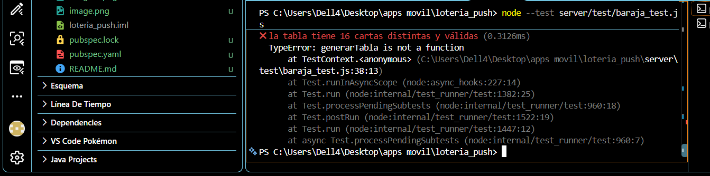

Paso 2.2 - Código de la baraja (VERDE)

Se crea baraja.js con 54 pares nombre y pista, a los que se asigna el id según su posición (del 1 al 54). Pasa porque cartaPorId devuelve CARTAS[id - 1] ?? null, así que los ids 0 y 55 dan null. barajar aplica Fisher-Yates con un generador con semilla (mulberry32), de modo que cada semilla produce siempre el mismo orden completo y distinto al de otra semilla. generarTabla toma las primeras 16 cartas de esa baraja, por lo que nunca se repiten.
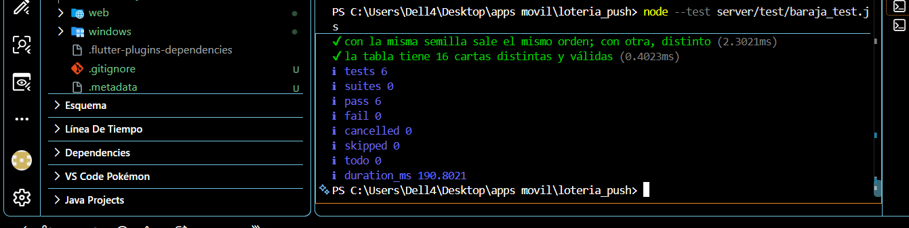

Paso 2.3 - Pruebas de las líneas ganadoras (ROJO)

La prueba falla porque server/test/lineas.test.js carga ../lineas, que no existe, y el archivo no puede ejecutarse. Las pruebas ya establecen que existen 13 patrones (llena, 4 filas, 4 columnas, 2 diagonales, esquinas y centro). También piden detectar cada patrón, no contar uno al que le falta una carta, ignorar cartas que no están en la tabla, devolver la carta que falta cuando solo falta una, y describir cada patrón en lenguaje humano.
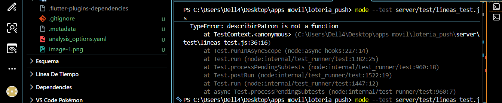

Paso 2.4 - Código de las líneas ganadoras (VERDE)

Se crea lineas.js, donde los patrones son datos (listas de posiciones de la tabla 4 por 4) y una sola función los recorre. Pasa porque patronesCompletos devuelve los patrones cuyas posiciones tienen todas la carta ya cantada; como "llena" va primero, una tabla llena da 13 patrones empezando por ella. cartaQueFalta devuelve null si ya hay patrón completo, salta "llena" para no avisar demasiado pronto y regresa el id cuando a un patrón le falta una sola carta. describirPatron arma "la fila 2" o "una diagonal".
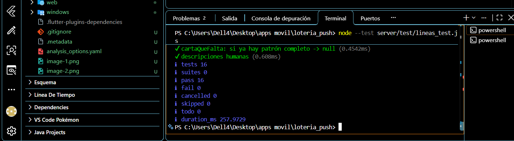

Paso 3.1 - Pruebas de los mensajes push (ROJO)

La prueba falla porque server/test/mensajes.test.js carga ../mensajes, que no existe, y no se ejecuta ninguna de sus pruebas. Las pruebas definen el formato que FCM exige: la carta va al tema de la sala, todos los valores de data son texto, la carta caduca en 60 segundos y colapsa en Android y en iOS. Además, "cartas" y "momentos" son canales distintos, un mensaje personal lleva token o fid sin tema, y uno de más de 4 KB se rechaza antes de enviarse.
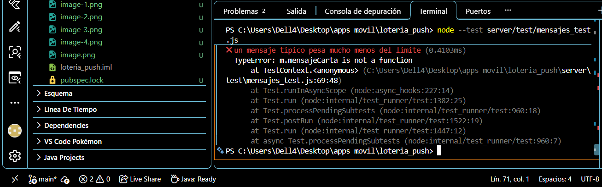

Paso 3.2 - Código de los mensajes push (VERDE)

Se crea mensajes.js con funciones puras que arman el objeto y no envían nada. Pasa porque aTexto convierte cada valor de data con String(...), y las funciones fijan el tema sala_X, el TTL de 60 s, el collapseKey, el tag y el apns-collapse-id (carta_X) y la expiración en segundos Unix. mensajeLoteria usa el canal "momentos", dura una hora y escribe "Ana ganó con la fila 1" con describirPatron. haciaDestino copia el mensaje sin tema y con token o fid, sin tocar el original, y comprobarTamano lanza un error "excede" pasados 4096 bytes.
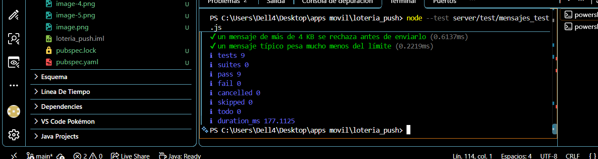

Paso 4.1 - Pruebas de la sala (ROJO)

La prueba falla porque server/test/sala.test.js carga ../sala, que no existe, y no se ejecuta. Las pruebas fijan el juego completo sin red: unirse con tabla de 16 y clave propia, nombres y destinos inválidos, sala llena a los 30 jugadores y cartas cantadas en el orden del mazo secreto. También exigen el freno de "muy rápido", que el estado nunca revele el mazo, el mismo error de autorización con clave mala o jugador inexistente, la validación de la Lotería por el servidor, el aviso de "casi" una sola vez y la clave del cantor.
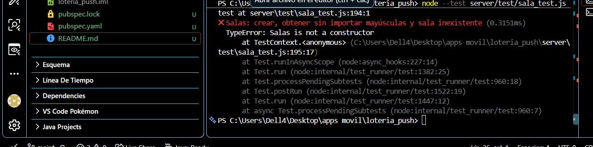

Paso 4.2 - Código de la sala (VERDE)

Se crea sala.js con Sala, Salas y ErrorJuego (con código y estado HTTP). Pasa porque unir valida el nombre con una expresión Unicode de 1 a 20 caracteres y el destino (token o fid de al menos 20 caracteres), y rechaza nombres repetidos y sala llena. _jugador compara claves con timingSafeEqual y lanza siempre NO_AUTORIZADO. cantar bloquea si ya hay ganador, exige 2 segundos entre cartas y saca la siguiente del mazo secreto, y estado devuelve copias de solo lo ya cantado. El aviso "casi" se calcula con cartaQueFalta y se manda una vez por jugador con destino.
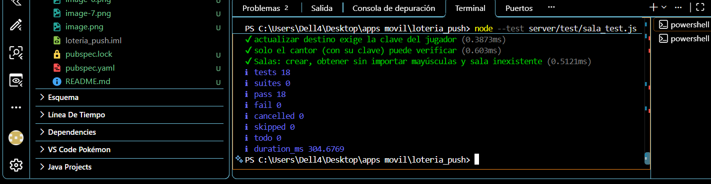

Paso 5.1 - Pruebas del servidor HTTP (ROJO)

La prueba falla porque server/test/servidor.test.js carga ../servidor, que no existe, y no puede levantar el servidor para hablarle con fetch. Con un enviador falso que registra lo que se manda, las pruebas fijan el flujo completo de crear, unirse y cantar, la clave del cantor, el freno con 429 y un solo push, y el estado desde n. También piden que el canto cuente aunque FCM falle, que el aviso personal vaya a un token y se elimine el token muerto, que invalid-argument no borre al jugador y que no se filtren detalles internos.
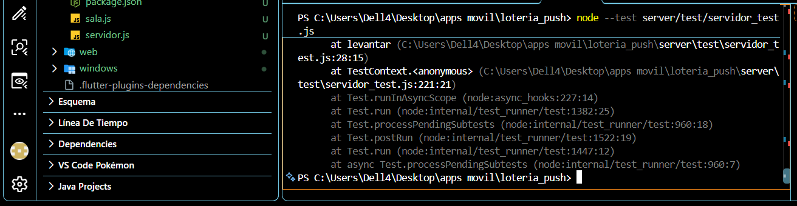

Paso 5.2 - Código del servidor HTTP (VERDE)

Se crea servidor.js, que recibe el enviador inyectado (enviador.js ya trae el enviador de consola, el de FCM y esDestinoMuerto). Pasa porque cada ruta se resuelve con una expresión regular y llama a la sala, y /cantar primero verifica la clave y envía la carta al tema y los "casi" por token. enviarSeguro captura el fallo, devuelve false, anota el error y solo quita el destino si el error es de token no registrado o inválido. leerJson limita el cuerpo a 2048 bytes (413 con connection: close), el JSON roto da 400 y un error interno responde "Error interno" con el detalle solo en el log.
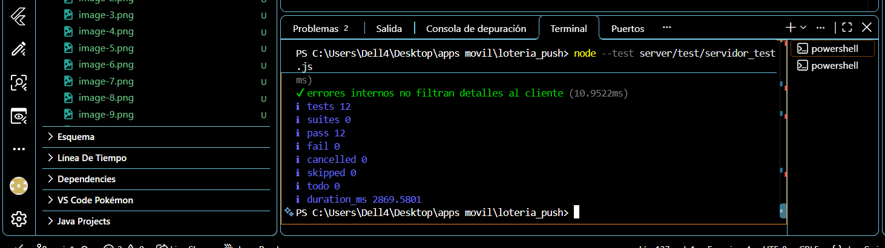

##primera partes, todos los test logrados
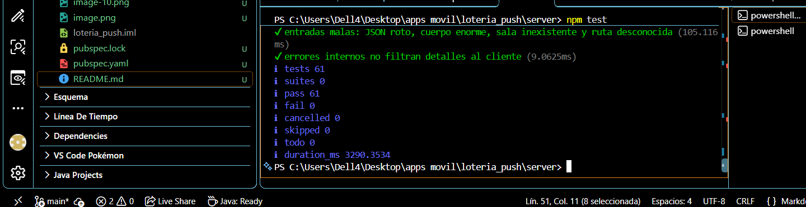

Paso 6.1 - Pruebas de eventos y patrones en la app (ROJO)

La prueba falla porque app/test/evento_lineas_test.dart importa evento.dart y lineas.dart, que todavía no existen en la app, y no compila. Las pruebas fijan que lo que llega por push es texto: n y cartaId llegan como "5", y los datos incompletos, fuera de rango (0, 55, 99), vacíos, gigantes o de tipo desconocido se descartan con null. salaDe debe normalizar a mayúsculas, y los patrones
 repiten los mismos casos del servidor, con 13 patrones en la tabla llena.
 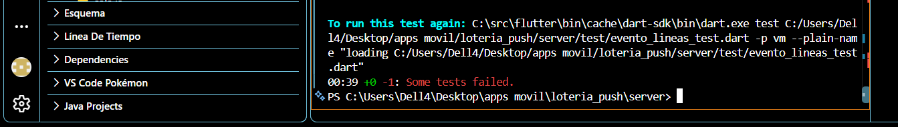

Paso 6.2 - Código de eventos y patrones en la app (VERDE)

Se crean evento.dart y lineas.dart (con cartas.dart como apoyo). Pasa porque EventoJuego.desdeDatos parsea con desconfianza: _entero acepta un entero o un texto convertible dentro del rango 1 a 54, _texto recorta y rechaza vacíos o demasiado largos, y cualquier tipo desconocido devuelve null. salaDe acepta de 1 a 8 caracteres y los pasa a mayúsculas. lineas.dart repite el mapa de patrones del servidor, con "llena" primero, y describirPatron genera los mismos textos humanos.
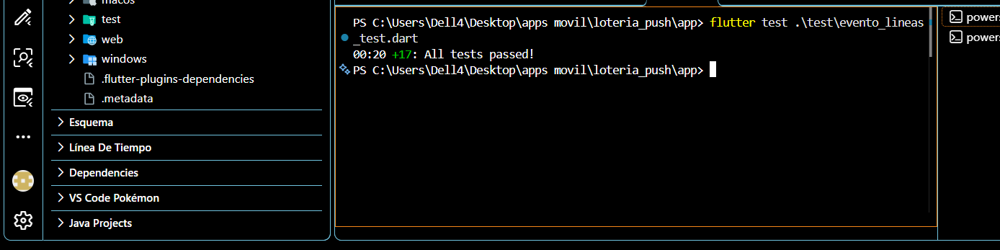

Paso 6.3 - Pruebas de la partida (ROJO)

La prueba falla porque app/test/partida_test.dart importa partida.dart, que no existe (además de los auxiliares de falsos.dart, que el manual presenta en la Ronda 7), y no compila. Las pruebas fijan las tres reglas de la partida: la carta siguiente se aplica, un push repetido es duplicado y no cambia nada, y una carta adelantada se detecta como hueco sin aplicarse. También piden que aplicarLote tolere desorden y repetidas, que el botón de Lotería se habilite solo con un patrón completo y que "casi" solo informe.
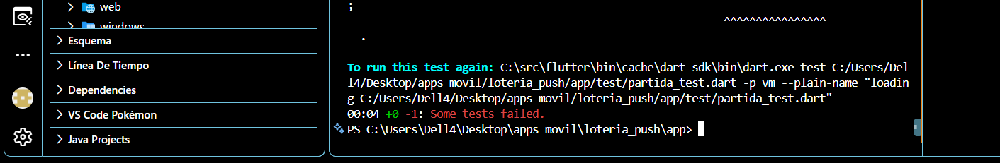

Paso 6.4 - Código de la partida (VERDE)

Se crea partida.dart con ResultadoAplicar y la clase Partida. Pasa porque aplicar compara el número de carta con la última: menor o igual es duplicado, mayor que la última más uno es hueco (no se agrega), y solo la siguiente exacta se aplica. aplicarLote ordena por número y aplica, así que con el lote 1, 2, 4 se detiene en la carta 2. puedeCantarLoteria exige que no haya ganador y que existan patrones completos, y un aviso de Lotería del mismo ganador se trata como duplicado.
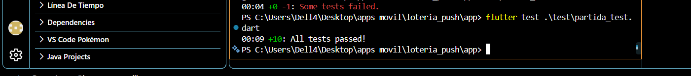

Paso 7.1 - Pruebas del controlador (ROJO)

La prueba falla porque controlador_test.dart usa ControladorPartida de controlador.dart, que todavía no existe (los puertos, el almacén, la sesión y los dobles de prueba ya están definidos), y no compila. Las pruebas definen: unirse con permiso registra el destino y se suscribe al tema, sin permiso no lo pide, y los pushes en orden no molestan al servidor. También exigen que un hueco dispare la sincronización, que se ignoren otras salas y basura, que dos sincronizaciones simultáneas hagan una sola consulta y que la sesión se restaure al abrir desde cerrada.
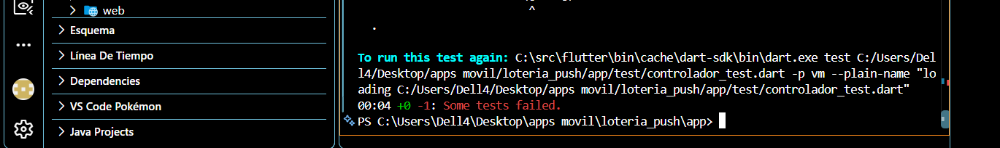

Paso 7.2 - Código del controlador (VERDE)

Se crea controlador.dart, que une la API, el push y la partida bajo la regla de que el push es un aviso y el servidor es la verdad. Pasa porque unirse consulta el permiso sin pedirlo, obtiene el destino solo si fue concedido y se suscribe a sala_X; _alRecibir ignora lo de otra sala o inválido, aplica el evento y llama a sincronizar si hay hueco. sincronizar pide el estado desde la última carta, usa una bandera para no duplicar consultas y guarda el error sin tronar. restaurar aplica la notificación inicial y siempre sincroniza, y reclamarLoteria marca al ganador solo si el servidor confirma.
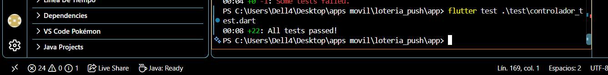